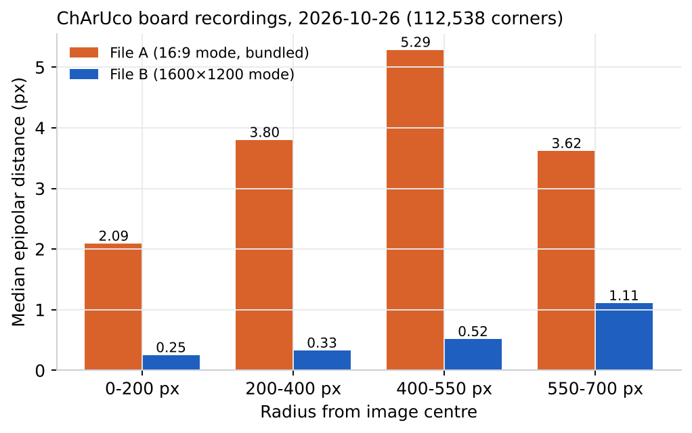
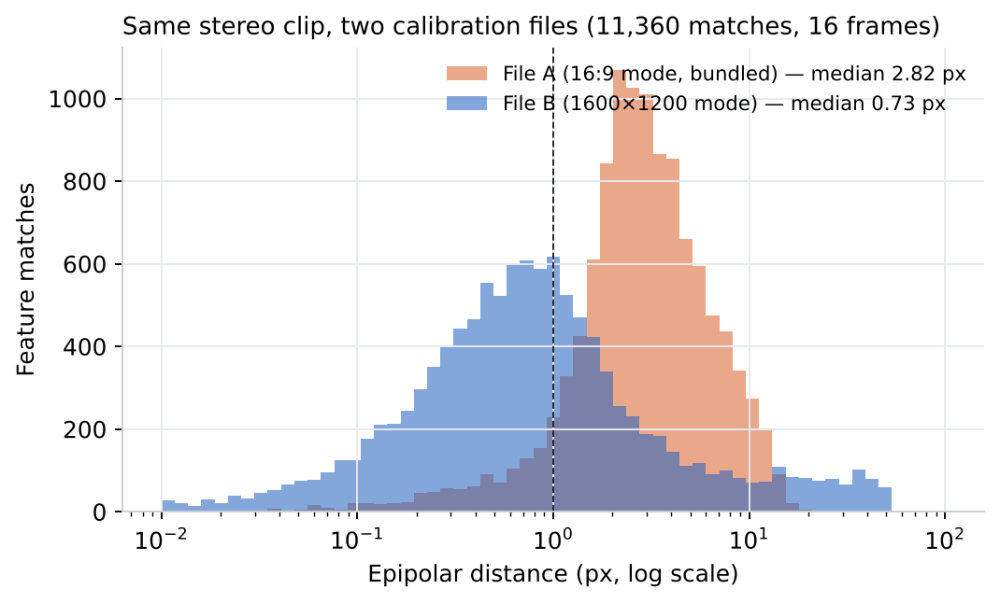
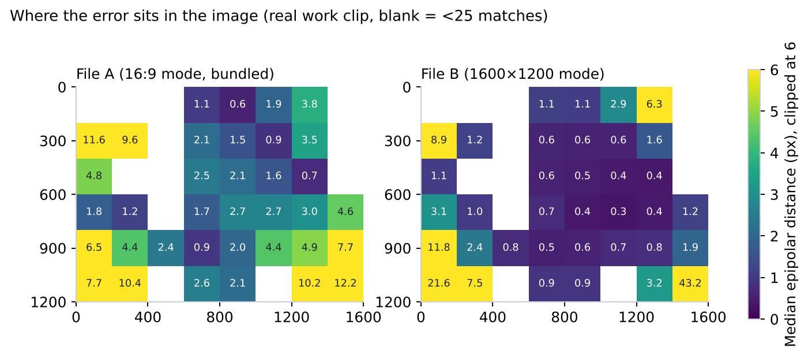

<!-- ODL_QUALITY_V2 -->

# Origin Data Lab · Technical Field Note #13

**ODL Stereo Calibration Mismatch Test**

[](https://github.com/origin-data-lab/stereo-calibration-sensor-mode-mismatch-diagnosis) [](https://huggingface.co/datasets/origin-data-lab/stereo-calibration-sensor-mode-mismatch-diagnosis) [](https://www.kaggle.com/datasets/origindatalab/odl-stereo-calibration-mismatch) [](https://origindatalab.io/technical-field-notes/stereo-calibration-sensor-mode-mismatch-diagnosis.html)

[English technical note](https://origindatalab.io/technical-field-notes/stereo-calibration-sensor-mode-mismatch-diagnosis.html) | [Korean technical note](https://origindatalab.io/ko/technical-field-notes/stereo-calibration-sensor-mode-mismatch-diagnosis.html)

---

# ODL Field Note #13 — Detecting a stereo calibration made for the wrong sensor mode
Compare two stereo calibrations on your own footage: file-level checks, epipolar distance on ChArUco corners, and a target-free epipolar check from left/right SIFT matches.
```bash
pip install opencv-contrib-python-headless==4.10.0.84 numpy pandas pyyaml matplotlib
PYTHONPATH=analysis python3 analysis/a7_calibration_mismatch.py <S1_package_dir> out
```
Manufacturer calibration files and the raw clip are not distributed. `a7_s1_matches.csv.gz` holds the per-match results for both files.
Licence: Creative Commons Attribution 4.0 International (CC BY 4.0) for derived data and figures; MIT for code.

## Visual evidence

Figures are taken from the released technical-note package. Interpret with the original methods and limitations.

### Figure 1



*Median epipolar distance by radius from the image centre, ChArUco recordings, both files.*

### Figure 2



*Epipolar distance of the same 11,360 matches under each file (log scale).*

### Figure 3



*Median epipolar distance per 200 px cell on the real work clip. Blank cells had fewer than 25 matches.*


<!-- ODL_ENTITY_V1 -->
## About Origin Data Lab

**Origin Data Lab** (origindatalab.io, OriginDataLab Co., Ltd.) is a real-world data collection company based in **Yangyang, Gangwon State, South Korea**.
We plan and run egocentric, stereo+IMU and field video capture for physical AI and robotics teams, with documented QA such as the measurements in this dataset.
Not affiliated with "Origin Lab" (game data) or "OriginLab" (Origin/OriginPro software).

- **[Request sample data](https://origindatalab.io/contact.html?topic=sample&note=fn13&utm_source=github&utm_medium=referral&utm_campaign=field-notes)**: stereo+IMU or phone+IMU egocentric capture
- **[Custom data collection](https://origindatalab.io/data-services.html?utm_source=github&utm_medium=referral)**: field capture in South Korea and Bangladesh
- **[All technical field notes](https://origindatalab.io/technical-field-notes/?utm_source=github&utm_medium=referral)**

---

## Explore Origin Data Lab

[](https://github.com/origin-data-lab/stereo-calibration-sensor-mode-mismatch-diagnosis) [](https://huggingface.co/datasets/origin-data-lab/stereo-calibration-sensor-mode-mismatch-diagnosis) [](https://www.kaggle.com/datasets/origindatalab/odl-stereo-calibration-mismatch) [](https://origindatalab.io/technical-field-notes/stereo-calibration-sensor-mode-mismatch-diagnosis.html)

[Official Website](https://origindatalab.io/) | [Technical Field Notes](https://origindatalab.io/technical-field-notes/) | [English Note](https://origindatalab.io/technical-field-notes/stereo-calibration-sensor-mode-mismatch-diagnosis.html) | [Korean Note](https://origindatalab.io/ko/technical-field-notes/stereo-calibration-sensor-mode-mismatch-diagnosis.html)

[GitHub](https://github.com/origin-data-lab/stereo-calibration-sensor-mode-mismatch-diagnosis) | [Hugging Face](https://huggingface.co/datasets/origin-data-lab/stereo-calibration-sensor-mode-mismatch-diagnosis) | [Kaggle Dataset](https://www.kaggle.com/datasets/origindatalab/odl-stereo-calibration-mismatch) | [Kaggle Notebook](https://www.kaggle.com/code/origindatalab/odl-stereo-calibration-mismatch-notebook)
